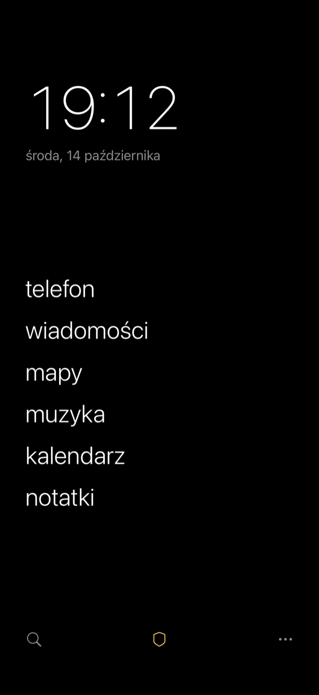
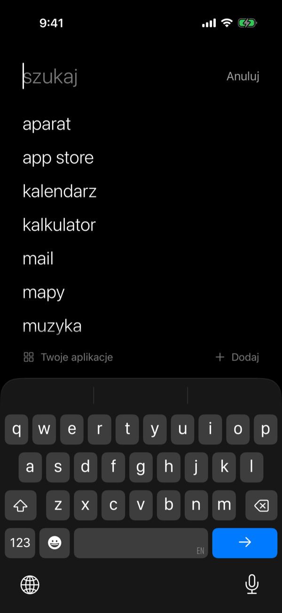
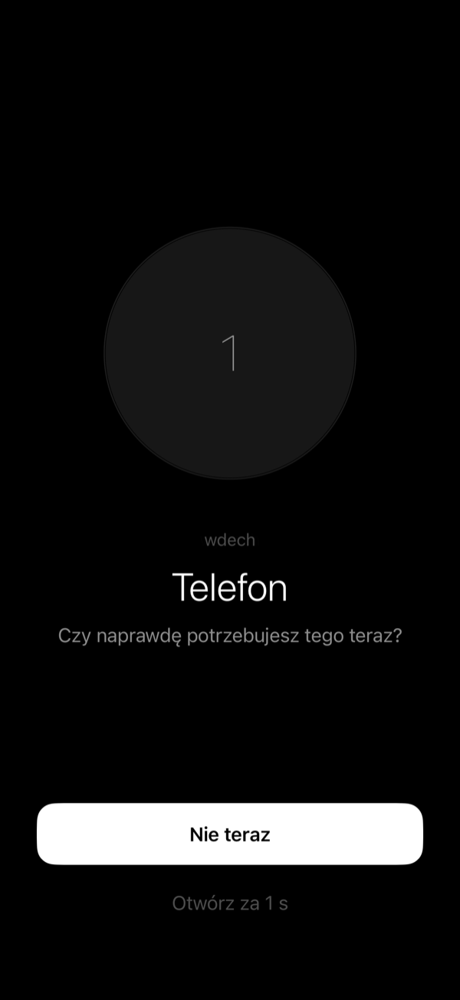
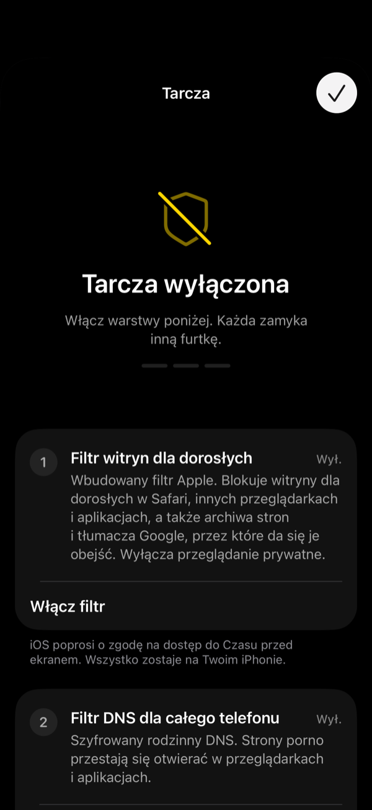

<p align="center">
  
</p>

<h1 align="center">minimal</h1>

<p align="center">
  <b>Wszystko, czego potrzebujesz. Nic, co rozprasza.</b><br>
  Minimalistyczny ekran dla iPhone’a — z tarczą, która blokuje strony porno w przeglądarkach i aplikacjach.
</p>

<p align="center">
  
  
  
  
</p>

---

## Co potrafi

| | |
|---|---|
| **Tylko słowa** | Zegar, data i kilka najważniejszych aplikacji, zapisanych zwykłym tekstem. Bez ikon, kolorów i czerwonych kropek. |
| **Wszystko pod ręką** | Każdą aplikację znajdziesz w sekundę — wystarczy zacząć pisać. Niczego nie tracisz: gotowy katalog ponad 80 aplikacji (także polskich), a każdą inną dodasz przez aplikację Skróty. |
| **Pauza** | Przy wybranych aplikacjach (Instagram, YouTube, X…) najpierw kilka sekund oddechu i pytanie, czy na pewno. Impuls mija, a Ty decydujesz świadomie. |
| **Tarcza** | Trzy warstwy blokady porno: filtr witryn dla dorosłych Apple, szyfrowany rodzinny DNS dla całego telefonu i blokada wybranych aplikacji. Do tego opcjonalne opóźnienie, zanim tarczę da się wyłączyć. |
| **Widżety** | „Ulubione” na ekran główny i ekran blokady oraz „Szukaj”, który otwiera wyszukiwanie jednym stuknięciem. |
| **Prywatność** | Bez kont, reklam i śledzenia. Twoje dane zostają na iPhonie — tylko filtr DNS wysyła (zaszyfrowane) zapytania o adresy stron do wybranego dostawcy. |

---

## Instalacja — około 15 minut (plus pobranie Xcode)

### Czego potrzebujesz

- **iPhone** z iOS 17 lub nowszym (zalecany iOS 26) i kabel do Maca.
- **Mac** z najnowszą aplikacją **Xcode** (darmowa w App Store; Xcode 26 wymaga macOS 15.6 lub nowszego). Pobierz ją wcześniej — Xcode i platforma iOS to kilkanaście GB.
- **Konto Apple**:
  - **płatne Apple Developer** (99 USD/rok): pełna, automatyczna tarcza, a aplikacja działa cały rok bez odświeżania. **Polecane.**
  - **zwykłe, darmowe konto Apple**: wszystko działa, ale tarczę ustawiasz ręcznie — poprowadzi Cię przewodnik w aplikacji. Aplikację trzeba odświeżać co 7 dni. Szczegóły w sekcji [Wersja Free](#wersja-free-darmowe-konto-apple).

### Krok po kroku

1. **Pobierz projekt.** Na GitHubie kliknij zielony przycisk **Code → Download ZIP** i rozpakuj plik. Możesz też wpisać w Terminalu `git clone`.
2. **Tylko przy darmowym koncie Apple:** otwórz plik `Config/Signing.xcconfig` w dowolnym edytorze i zmień `MINIMAL_EDITION = Full` na `MINIMAL_EDITION = Free`. Z płatnym kontem pomiń ten krok.
3. **Otwórz `Minimal.xcodeproj`** (dwuklik). Jeśli Xcode poprosi o pobranie platformy iOS, zgódź się i poczekaj.
4. **Zaloguj się w Xcode:** **Xcode → Settings → Accounts → ＋ → Apple Account**.
5. **Podłącz iPhone’a** kablem i odblokuj go. Na pytanie „Ufać temu komputerowi?” stuknij **Ufaj** i podaj kod.
6. **Włącz tryb dewelopera** na iPhonie: **Ustawienia → Prywatność i ochrona → Tryb dewelopera → Włącz → Uruchom ponownie**. Po restarcie odblokuj iPhone’a, w komunikacie stuknij **Włącz** i podaj kod. (Opcja pojawia się dopiero po podłączeniu iPhone’a do Xcode.)
7. **Wybierz iPhone’a** na górnym pasku Xcode (obok nazwy Minimal).
8. **Wybierz zespół:** w lewym panelu kliknij niebieską ikonę **Minimal**, potem target **Minimal**, kartę **Signing & Capabilities** i w polu **Team** wybierz swoje konto. Powtórz to samo dla targetu **MinimalWidget**. Z płatnym kontem wybierz zespół **bez** dopisku „(Personal Team)”. Identyfikatory aplikacji utworzą się same z Twojego Team ID.
9. **Naciśnij ▶︎** (⌘R). Pierwsza instalacja trwa chwilę.
10. **Darmowe konto Apple?** iPhone poprosi o zaufanie deweloperowi: **Ustawienia → Ogólne → VPN i urządzenia zarządzane → Aplikacja dewelopera → [Twoje konto] → Ufaj**. Potem naciśnij **▶︎** jeszcze raz albo stuknij ikonę Minimal.
11. **Gotowe.** Minimal przeprowadzi Cię przez resztę: wybór aplikacji, tarczę i ustawienie ekranu.

> Wolisz nie klikać w Xcode? Utwórz plik `Config/Signing.local.xcconfig` z jedną linią `DEVELOPMENT_TEAM = TWÓJ_TEAM_ID` (Team ID znajdziesz na [developer.apple.com/account](https://developer.apple.com/account) → Membership details; z darmowym kontem po prostu wybierz zespół w kroku 8). Ten plik nie trafia do gita, a zespół ustawia się wtedy w obu targetach naraz.

### Gdy Xcode pokaże błąd

| Komunikat | Co zrobić |
|---|---|
| **Your team has no devices…** / **No profiles for … were found** | Podłącz iPhone’a, wybierz go na górnym pasku (krok 7) i naciśnij **▶︎** albo **Try Again** — Xcode sam go zarejestruje. |
| **Signing for "Minimal" (albo "MinimalWidget") requires a development team** | Krok 8: wybierz zespół w obu targetach. |
| **Personal development teams … do not support the Family Controls** (albo **Network Extensions**) | Masz płatne konto? W kroku 8 wybierz zespół bez dopisku „(Personal Team)”. Masz darmowe konto? Ustaw `MINIMAL_EDITION = Free` w `Config/Signing.xcconfig` (patrz [Wersja Free](#wersja-free-darmowe-konto-apple)). |
| **…maximum App ID limit…** / **…maximum number of apps for free development profiles…** | Minimal z widżetem zajmuje 2 identyfikatory (limit darmowego konta: 10 na 7 dni — trzeba odczekać) i więcej niż jedno z miejsc na aplikacje z darmowego konta (usuń z iPhone’a inną aplikację zainstalowaną z Xcode). |
| **Provisioning profile doesn't include the App Groups entitlement** | W **Signing & Capabilities → App Groups** kliknij ↻ albo zaznacz grupę `group.pl.minimal.<Team ID>.minimal`. Zrób to dla obu targetów. |
| **PLA Update available** | Zaloguj się na [developer.apple.com/account](https://developer.apple.com/account) i zaakceptuj nową umowę licencyjną. |
| **iOS … is not installed** | Xcode → Settings → Components → pobierz platformę iOS. |
| **Developer Mode disabled** / iPhone nie pojawia się w Xcode | Krok 6: włącz Tryb dewelopera i odblokuj iPhone’a. |
| **…has not been explicitly trusted by the user** | Krok 10: zaufaj deweloperowi w Ustawieniach. |

### Ustaw ekran jak dumbphone (2 minuty)

iOS nie pozwala żadnej aplikacji zastąpić ekranu głównego. Da się go jednak ustawić tak, że widzisz tylko Minimal:

1. **Widżet:** przytrzymaj puste miejsce na ekranie → **Edytuj → Dodaj widżet → Minimal → Ulubione** (duży).
2. **Reszta do biblioteki:** pozostałe ikony przenieś do biblioteki aplikacji i ukryj zbędne strony ekranu.
3. **Dock:** zostaw w nim tylko Minimal.
4. **Czerń i szarość:** ustaw czarną tapetę i skrót do skali szarości (trzykrotne naciśnięcie przycisku bocznego).

Dokładne ścieżki znajdziesz w aplikacji: **⋯ → Przewodnik po minimalizmie**.

**Przycisk czynności i Spotlight:** Minimal dodaje skróty „Szukaj w Minimal” i „Pokaż tarczę Minimal”. Przypisz pierwszy do przycisku czynności (**Ustawienia → Przycisk czynności → Skrót**), a jedno naciśnięcie otworzy wyszukiwanie wszystkich aplikacji.

---

## Tarcza

| Warstwa | Co blokuje | Jak działa |
|---|---|---|
| **1. Filtr witryn dla dorosłych** | Strony porno w Safari, Chrome, Firefoksie i przeglądarkach wewnątrz aplikacji. Wyłącza też przeglądanie prywatne. | Wbudowany filtr Apple (Screen Time API), ten sam co „Blokuj witryny dla dorosłych”. |
| **2. Filtr DNS** | Strony porno w **każdej** aplikacji. Wymusza bezpieczne wyszukiwanie (także obrazów) i tryb ograniczonego dostępu w YouTube, blokuje VPN-y i proxy. | Szyfrowany rodzinny DNS ([CleanBrowsing Family](https://cleanbrowsing.org/filters/), do wyboru również AdGuard i Cloudflare). |
| **3. Zablokowane aplikacje** | Aplikacje, w których łatwo trafić na porno (np. X, Reddit, Telegram), albo całe kategorie. | Osłona Screen Time na wybranych aplikacjach. |
| **Zobowiązanie** | Wyłączenie czegokolwiek wymaga odczekania (od 1 godz. do 7 dni). Opcjonalnie blokada usuwania aplikacji. | Licznik w aplikacji i `denyAppRemoval`. |

**Po instalacji filtra DNS** trzeba go jeszcze włączyć ręcznie: **Ustawienia → Ogólne → VPN i urządzenia zarządzane → DNS → Minimal**. iOS wymaga, żeby ten jeden krok zrobił człowiek.

### Uczciwie: czy da się to obejść?

Na prywatnym iPhonie każdą blokadę można w końcu wyłączyć. Tarcza ma sprawić, żeby było to trudne, powolne i świadome. Najmocniejszy zestaw:

- **Kod Czasu przed ekranem u zaufanej osoby.** W iOS 26.4 i nowszych bez tego kodu nie da się odebrać Minimal dostępu do Czasu przed ekranem.
- W Czasie przed ekranem zablokuj **zmiany kodu i konta**.
- Włącz **ostrzeżenia dotyczące treści wymagających dyskrecji** (Prywatność i ochrona). iPhone rozmyje wtedy nagie zdjęcia w Wiadomościach, AirDropie i FaceTimie.
- Nie instaluj aplikacji VPN, bo omijają filtr DNS.

Pełna lista jest w aplikacji: **Tarcza → Maksymalna ochrona**.

---

## Wersja Free (darmowe konto Apple)

Darmowe konto Apple nie daje dostępu do Screen Time API ani ustawień DNS, więc tarcza nie może włączyć się sama. W pliku `Config/Signing.xcconfig` ustaw:

```
MINIMAL_EDITION = Free
```

Wszystko inne działa tak samo. Na ekranie **Tarcza** aplikacja poprowadzi Cię przez:

1. wbudowany filtr Apple („Blokuj witryny dla dorosłych”),
2. instalację **profilu DNS**: gotowe pliki są w folderze [`Profiles/`](Profiles), a aplikacja może je od razu zapisać w Plikach,
3. limity aplikacji w Czasie przed ekranem.

Aplikacje zainstalowane z darmowego konta wygasają po 7 dniach. Wtedy podłącz iPhone’a i znowu naciśnij **▶︎** w Xcode.

### Tylko tarcza, bez aplikacji

Chcesz samą blokadę? Wyślij na iPhone’a jeden z plików z folderu [`Profiles/`](Profiles) (AirDrop, Mail, iCloud Drive) i otwórz go. Potem przejdź do **Ustawienia → Profil pobrany → Instaluj**.

---

## Jak dodać aplikację, której nie ma w katalogu

Każdą aplikację z iPhone’a da się otworzyć przez aplikację **Skróty**:

1. Skróty → **＋** → **Dodaj czynność** → **Otwórz aplikację** → wybierz aplikację.
2. Nazwij skrót, np. „Otwórz Aparat”.
3. W Minimal: **Szukaj → Dodaj → Skrót**, wpisz tę samą nazwę.

---

## Dla programistów

```
Minimal/            aplikacja (SwiftUI, iOS 17+)
  Model/            dane, katalog aplikacji, routing, statystyki
  Shield/           tarcza: FamilyControls, ManagedSettings, NEDNSSettingsManager
  Views/            ekrany
MinimalWidget/      widżety (WidgetKit)
Shared/             kod wspólny dla aplikacji i widżetu (App Group)
Profiles/           profile DNS (.mobileconfig) dla wersji Free
Config/             podpisywanie i edycja (Full/Free)
scripts/            generator projektu Xcode, ikona, profile, zrzuty ekranu
```

- Projekt Xcode jest generowany skryptem: `gem install xcodeproj && ruby scripts/generate_project.rb`. Uruchom go po dodaniu lub usunięciu plików (skrypt kasuje zespół wybrany w Xcode — używaj wtedy `Config/Signing.local.xcconfig`).
- Przy każdym pushu CI (GitHub Actions, macOS) buduje aplikację na symulator i na iPhone’a oraz tworzy niepodpisany plik `.ipa` (wersja Free, tylko do sprawdzenia kompilacji — to nie jest droga instalacji: po ponownym podpisaniu widżet nie zobaczy danych aplikacji; w pełni działa tylko instalacja z Xcode). Commit z `[shots]` w opisie dodatkowo odświeża zrzuty ekranu w `docs/screenshots`.
- Deep linki: `minimalphone://search`, `minimalphone://shield`, `minimalphone://settings`, `minimalphone://open/<id lub id-z-katalogu>`. Przydają się w Skrótach i pod przyciskiem czynności.
- Aplikacja jest przeznaczona do instalacji z Xcode na własnym iPhonie. Publikacja w App Store wymagałaby osobnej zgody Apple na uprawnienie Family Controls (Distribution) i rezygnacji z niepublicznego adresu `prefs:` (otwieranie Ustawień).
